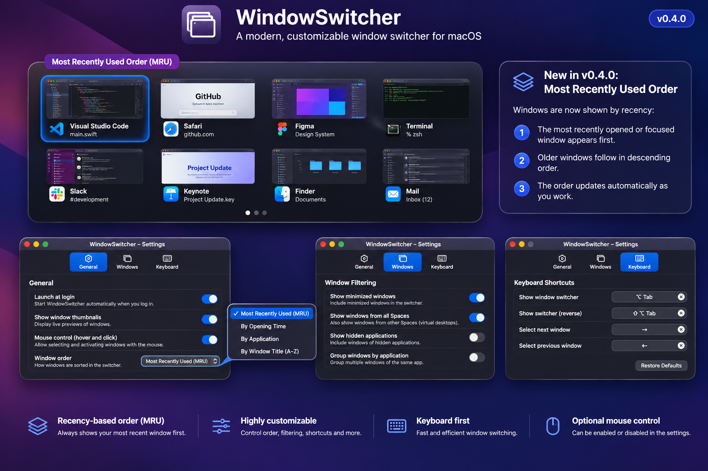
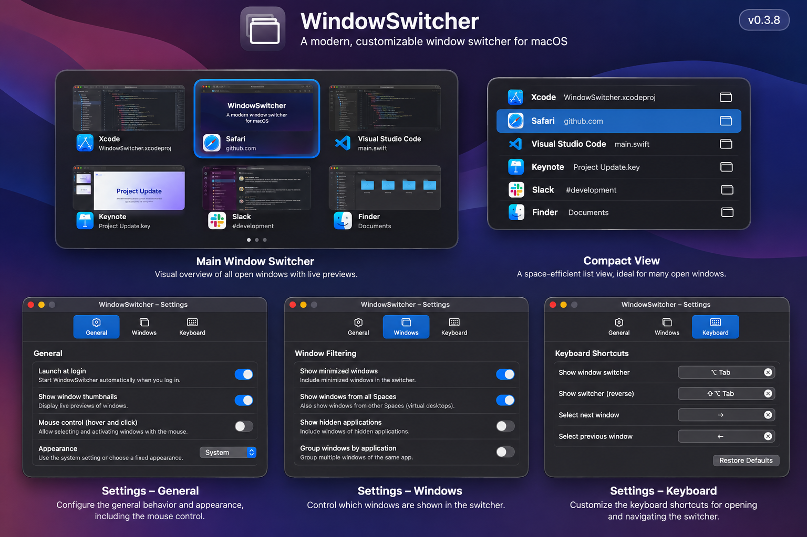
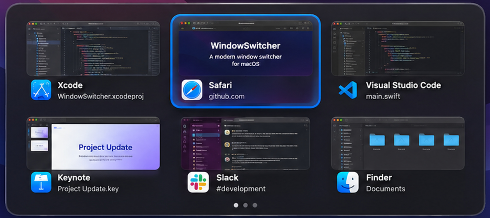
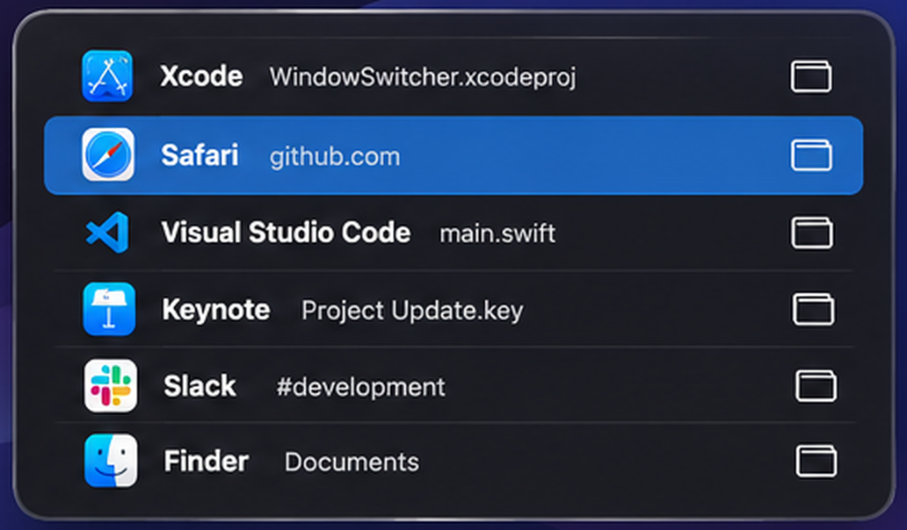
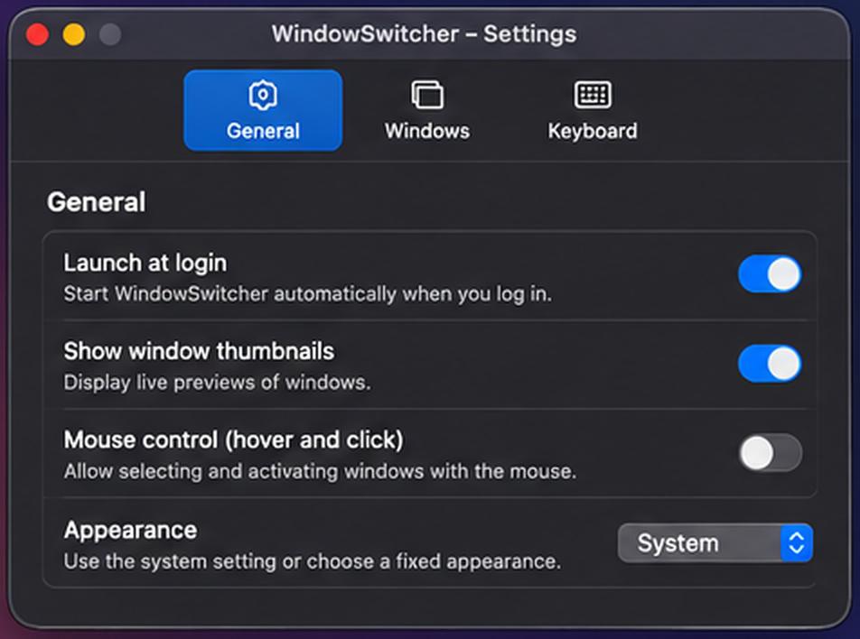
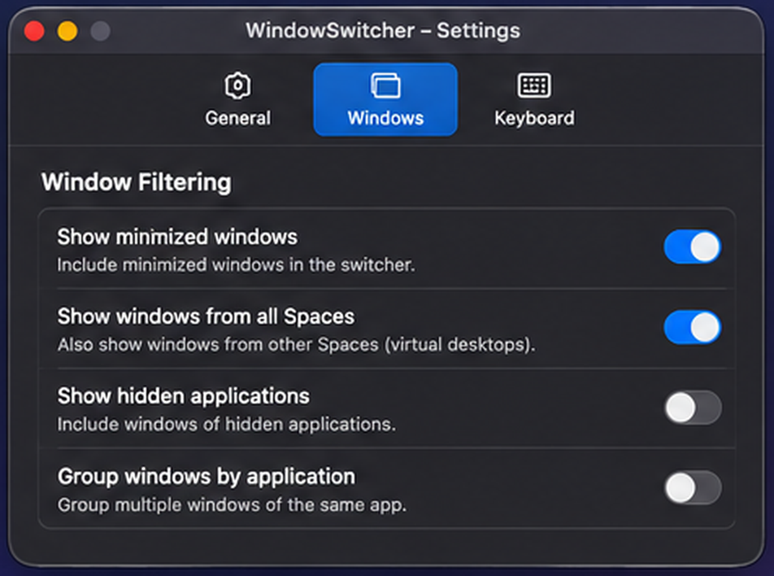
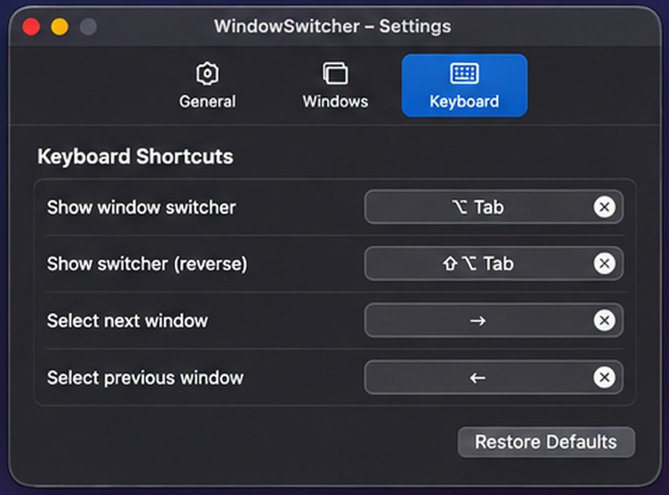
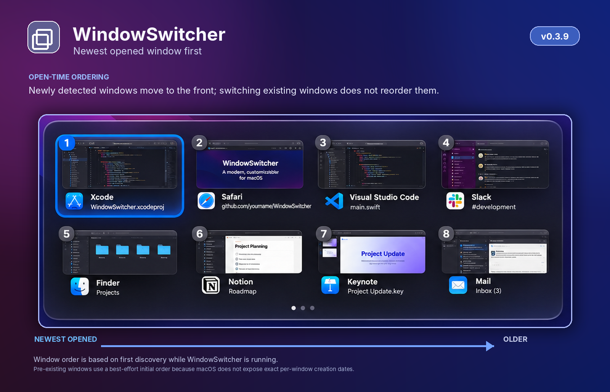

# WindowSwitcher

This application was vibecoded with ChatGPT Go.

A native macOS window switcher built with Swift and AppKit. WindowSwitcher presents individual application windows in a keyboard-driven overview, with optional mouse selection, configurable appearance, and window filters.

> **UI mockups:** Images in this repository are illustrative, AI-assisted design mockups. They are not screenshots captured from a running build and may show sample content or visual details that differ from the current implementation.

## What's new in 0.4.0

- **Most-recently-used (MRU) ordering:** the currently focused window is kept at the top of the switcher, followed by windows in the order they were last focused.
- **Intra-application focus tracking:** switching between two windows of the same app updates the MRU order as well.
- **Activation notifications:** `NSWorkspace` application activation notifications and per-application Accessibility focus notifications update the list as focus changes.
- **Polling fallback:** a lightweight foreground-focus poll supplements Accessibility notifications for applications that do not reliably publish focus events.
- **Updated GitHub mockup:** added a new visual concept showing MRU ordering.

## MRU window ordering

WindowSwitcher keeps a session-level MRU list for individual windows. The most recently focused window is displayed first. Older windows follow in descending order of their last focus/activation.

When you press `Option + Tab`, the currently focused window remains at the first position and the next-most-recent window is selected. Releasing `Option` activates the selected window. The next invocation reflects that activation immediately. `Shift + Option + Tab` starts in the reverse direction.

MRU updates are based on actual focus changes, not on window creation time or the current Window Server stacking order:

1. `NSWorkspace.didActivateApplicationNotification` detects changes between applications.
2. An `AXObserver` listens for `kAXFocusedWindowChangedNotification` for each regular application, allowing WindowSwitcher to detect focus changes between windows in the same app.
3. A 350 ms foreground-window check acts as a fallback for apps that do not publish the expected Accessibility notifications.
4. A 750 ms discovery pass adds newly created windows to the catalog. A newly opened window moves to the front when it becomes the focused window.

### macOS limitations

- Public macOS APIs do not expose a complete historical MRU timeline for arbitrary windows. When WindowSwitcher first starts, the currently focused window is placed first; the initial order of other already-open windows is seeded from the Window Server's front-to-back list and is therefore best effort.
- Focus tracking depends on the Accessibility API. Apps with incomplete or delayed Accessibility support may update through the polling fallback rather than immediately.
- The MRU list is kept in memory for the current WindowSwitcher session and is rebuilt when the app is relaunched.
- Windows hidden by the user's filters can still participate in MRU tracking, but are omitted from the visible switcher list.

## Interface mockups

### Most-recently-used ordering (0.4.0)



### Main switcher and other views



<details>
<summary>More UI concepts</summary>

#### Main window switcher



#### Compact view



#### General settings



#### Window settings



#### Keyboard settings



#### Previous opened-time ordering concept (0.3.9)



</details>

## Features

- Window overview using `Option + Tab`
- Reverse navigation using `Shift + Option + Tab`
- MRU ordering across individual windows, including windows within the same application
- Keyboard navigation with arrow keys
- Optional mouse hover selection and click-to-activate
- Window cards with thumbnails, app icons, and titles
- Alternative views: app icons and compact list
- Settings for appearance, window filters, and keyboard shortcuts
- Filters for minimized windows, hidden applications, and other Spaces
- Exclusion list based on bundle identifiers
- Duplicate filtering between Core Graphics and Accessibility window records
- Menu bar integration

## Requirements

- macOS 13 or later
- Apple Silicon or Intel Mac
- Swift 5.9 or later
- Xcode or Xcode Command Line Tools

## Build

Run the following commands from the project directory:

```bash
chmod +x scripts/build-app.sh
rm -rf .build build
./scripts/build-app.sh
```

The app bundle is created at `build/WindowSwitcher.app`. Launch it with:

```bash
open build/WindowSwitcher.app
```

The build script creates a local app bundle, generates `AppIcon.icns`, and applies ad-hoc signing. Administrator privileges are not required.

## Keyboard controls

| Shortcut | Action |
| --- | --- |
| `Option + Tab` | Open the switcher / select the next-most-recent window |
| `Shift + Option + Tab` | Start switching in reverse MRU order |
| Arrow keys | Move the selection |
| `Escape` | Cancel without changing the MRU order |
| Release `Option` | Activate the selected window and promote it to MRU position 1 |

The shortcut can be configured in the app's settings.

## Mouse control

Mouse control can be enabled or disabled in **Settings → General**. When disabled, hover and click interactions on window cards are ignored; keyboard navigation remains available.

## macOS permissions

- **Accessibility:** required to activate a specific window, read window attributes, and subscribe to per-app focused-window notifications.
- **Input Monitoring:** may be required by the global keyboard monitor.
- **Screen Recording:** required only for window thumbnails. Without this permission, app icons and window titles remain available where macOS provides them.

Manage these permissions under **System Settings → Privacy & Security**.

## Window detection and duplicate filtering

Window discovery combines Core Graphics and Accessibility metadata. When an app provides Accessibility window information, each recognized AX entry is matched to no more than one Core Graphics window. Duplicate AX entries with the same window ID are removed. Entries without a window ID are checked for duplicates using title and geometry. Ambiguous Window Server entries are omitted rather than displayed as extra cards.

Distinct document windows belonging to the same application remain separate entries. Deduplication is intended to remove multiple technical representations of the same window, not to combine all windows belonging to one app.

## Known limitations

- The public macOS APIs used by the app do not provide a simple, reliable Space ID for every window. Detection of windows on other Spaces is best effort.
- Some applications provide incomplete Accessibility metadata. Ambiguous windows may be omitted to avoid duplicate cards.
- Initial MRU order for windows that were already open before WindowSwitcher starts is approximate after the current focused window; macOS does not expose their complete historical focus order.
- Apps that do not emit focused-window Accessibility notifications rely on the foreground polling fallback, so intra-app MRU changes may be delayed by up to roughly one polling interval.
- MRU history is session-local and is rebuilt when WindowSwitcher is relaunched.

## Documentation

- Version history: [CHANGELOG.md](CHANGELOG.md)
- Mockup image notes: [docs/images/README.md](docs/images/README.md)
